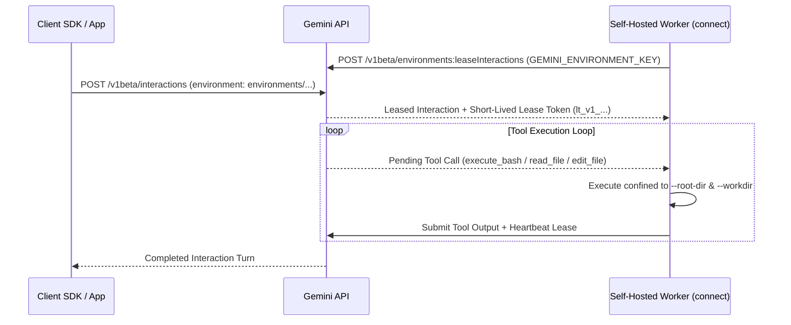
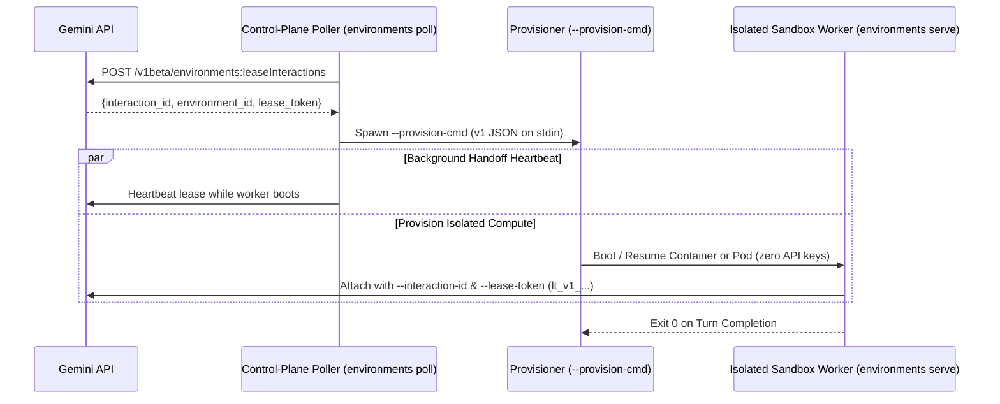

# Gemini API Managed Agents — Self-Hosted Environments

This guide provides reference architectures, deployment manifests,
container recipes, and provider guides for running **Self-Hosted Environments**
with the
[Gemini API](https://ai.google.dev/gemini-api/docs)
(`generativelanguage.googleapis.com`). To create a Gemini API key in Google AI
Studio, see
[Get a Gemini API key](https://ai.google.dev/gemini-api/docs/api-key).

With Self-Hosted Environments, Gemini API server-side agents execute built-in
filesystem and shell tools (`execute_bash`, `view_file` / `read_file`,
`write_to_file` / `write_file`, `replace_file_content` / `edit_file`,
`list_dir`, `grep_search`, `find_by_name`) inside compute infrastructure that
you control—using **100% outbound HTTPS connections** with no inbound firewall
ports required.

--------------------------------------------------------------------------------

## Architecture Overview

The self-hosted environment runtime is shipped directly in the open-source
[`gemini-api` CLI](https://github.com/google-gemini/gemini-api-cli) and supports
two execution topologies:

### Single-Worker Mode (`gemini-api environments connect`)

A single worker process runs inside your container, VM, or cloud microVM,
attaches to a `SELF_HOSTED` environment, polls
`POST /v1beta/environments:leaseInteractions`, and executes tool calls locally
inside its `--root-dir`:



```bash
gemini-api environments connect \
  --environment-key "$GEMINI_ENVIRONMENT_KEY" \
  --root-dir /workspace \
  --workdir /workspace
```

-   First create a self-hosted environment (`POST /v1beta/environments` with
    `{"mode": "self_hosted"}`) using your `GEMINI_API_KEY` to obtain an `id`
    (`environments/...`) and a scoped `environment_key` (`ek_...`). Save
    `environment_key` immediately—the API returns it **only once at creation
    time**.
-   Pass only `GEMINI_ENVIRONMENT_KEY` (`--environment-key`) into the worker so
    your project-wide `GEMINI_API_KEY` does not need to reside inside the
    execution environment.

--------------------------------------------------------------------------------

### Split Poller and Sandbox Workers (`gemini-api environments poll` + `gemini-api environments serve`)

For self-managed container or Agent Substrate clusters
([`containers/`](./containers/) and [`agent-substrate/`](./agent-substrate/)),
the split poller/worker mode separates the **trusted control plane** (which
holds `GEMINI_API_KEY` or `GEMINI_ENVIRONMENT_KEY`) from **untrusted ephemeral
execution containers or Pods** (which hold **zero API keys**, receiving only a
short-lived, interaction-scoped `--lease-token`):



1.  **Control-Plane Poller (`gemini-api environments poll`)**: Polls the Gemini
    API, maintains background handoff heartbeats while compute boots, and
    invokes `--provision-cmd` passing a `v1` JSON payload on `stdin`:

    ```json
    {
      "schema_version": "v1",
      "interaction_id": "int_...",
      "environment_id": "environments/...",
      "lease_token": "lt_v1_...",
      "server_url": "https://generativelanguage.googleapis.com",
      "environment_config": {
        "custom_config": {
          "your_key": "your provisioner-defined value"
        }
      }
    }
    ```

    `custom_config` is arbitrary JSON that you set on the environment or
    interaction. The Gemini API passes it through unchanged for your provisioner
    to interpret (for example, [`agent-substrate/`](./agent-substrate/) reads
    `atespace`, `template`, `env`, and a Substrate `egress_policy`).
2.  **Isolated Sandbox Worker (`gemini-api environments serve`)**: Runs inside
    the untrusted container or Pod using only the short-lived lease token:

    ```bash
    gemini-api environments serve \
      --interaction-id "$INTERACTION_ID" \
      --lease-token "$LEASE_TOKEN" \
      --root-dir /workspace \
      --workdir /workspace
    ```

--------------------------------------------------------------------------------

## Directory Index

<!-- mdformat off(GFM single-line table for GitHub compatibility) -->
Platform / Target                | Directory                                              | Execution Modes                                  | Description
:------------------------------- | :----------------------------------------------------- | :----------------------------------------------- | :----------
**Local Host (Unsafe)**          | [`local/`](./local/)                                   | Single-worker (`connect`)                        | Run the runtime directly on your machine for quick testing. **Includes critical warnings about `execute_bash` host exposure.**
**Docker & Podman**              | [`containers/`](./containers/)                         | Single-worker & Split (`connect`, `poll`/`serve`) | Hardened multi-stage `Dockerfile` / `Containerfile`, [`containers/docker/`](./containers/docker/) CLI recipes, and rootless [`containers/podman/`](./containers/podman/) CLI recipes.
**Agent Substrate (Kubernetes)** | [`agent-substrate/`](./agent-substrate/)               | Split (`ate-gemini`)                             | Full Go glue code (`ate-gemini` controller + in-pod actor daemon) integrating with Agent Substrate `v1` (`ate.dev/v1` `WorkerPool`, `go.ate.dev/substrate` `ActorTemplate`, and `atenet-router`) on Kubernetes.
**Cloud & MicroVM Providers**    | [`providers/`](./providers/)                           | Single-worker (`connect`)                        | Overview and shared 3-step setup pattern across all supported cloud and microVM providers.
**Vercel Sandbox**               | [`providers/vercel/`](./providers/vercel/)             | Single-worker (`connect`)                        | 3-step setup using the Vercel `sandbox` CLI (`sandbox create`, `sandbox exec`).
**Daytona**                      | [`providers/daytona/`](./providers/daytona/)           | Single-worker (`connect`)                        | 3-step setup using the `daytona` CLI (`daytona create`, `daytona exec`).
**E2B**                          | [`providers/e2b/`](./providers/e2b/)                   | Single-worker (`connect`)                        | 3-step setup using the `e2b` CLI (`e2b sandbox create`).
**Modal**                        | [`providers/modal/`](./providers/modal/)               | Single-worker (`connect`)                        | 3-step setup using the `modal` CLI (`modal shell`).
**Fly.io (Sprites & Machines)**  | [`providers/fly-machines/`](./providers/fly-machines/) | Single-worker (`connect`)                        | 3-step setup using the Fly.io `sprite` CLI (`sprite create`, `sprite exec`) or `fly` CLI (`fly machine run`).
**Google Cloud Run**             | [`providers/cloud-run/`](./providers/cloud-run/)       | Single-worker (`connect`)                        | 3-step setup using the `gcloud` CLI (`gcloud run jobs deploy`, `gcloud run jobs execute`, `gemini-api agent run`).
**Cloudflare Sandbox**           | [`providers/cloudflare/`](./providers/cloudflare/)     | Single-worker (`connect`)                        | Cloudflare Container + Worker deployed with `npx wrangler deploy`.
<!-- mdformat on -->

--------------------------------------------------------------------------------

## Built-In Runtime Tools

Every self-hosted worker provides the following 7 built-in tools (plus common
tool name aliases) to Gemini API agents out of the box:

<!-- mdformat off(GFM single-line table for GitHub compatibility) -->
Category                  | Tool Name (Aliases)                                                                                               | Confinement Behavior
:------------------------ | :---------------------------------------------------------------------------------------------------------------- | :-------------------
**Shell Execution**       | `execute_bash` (`run_command`, `run_shell_command`, `bash`, `shell`)                                              | Starts in `--workdir` (`--command-timeout`, max 4 MiB output, scrubbed OS env allowlist). Can be disabled via `--disable-bash`. **Requires OS/container/VM isolation.**
**File Reading & Search** | `view_file` (`read_file`), `list_dir` (`read_dir`, `list_directory`), `grep_search`, `find_by_name` (`find_file`) | Strictly confined to `--root-dir` via `os.Root` (blocks `..` traversal and symlinks escaping `--root-dir`).
**File Mutation**         | `write_to_file` (`write_file`), `replace_file_content` (`edit_file`)                                              | Strictly confined to `--root-dir` via `os.Root` (blocks `..` traversal and symlinks escaping `--root-dir`).
<!-- mdformat on -->

--------------------------------------------------------------------------------

## Security Best Practices

> [!WARNING]
> **Always isolate `execute_bash` inside a container, microVM, or VM.** While
> `--root-dir` strictly confines the structured file tools (`read_file`,
> `write_file`, `edit_file`, etc.), `execute_bash` executes arbitrary
> model-generated shell commands (`bash -c ...`). Only run [`local/`](./local/)
> inside throwaway development environments, and use containers, Agent
> Substrate, or microVM providers for untrusted workloads.

1.  **Scoped Environment Keys (`environments connect`)**: When running
    `gemini-api environments connect` inside a container or microVM provider,
    authenticate the worker with `GEMINI_ENVIRONMENT_KEY` (`--environment-key`)
    rather than a project-wide `GEMINI_API_KEY`.
2.  **Zero API Keys in Sandbox Workers (`environments poll` + `serve`)**: On
    self-managed Docker, Podman, or Agent Substrate clusters, run
    `gemini-api environments poll` in your control plane and pass only
    `--interaction-id` and `--lease-token` (`lt_v1_...`) into worker containers
    running `gemini-api environments serve`.
3.  **Least-Privilege Runtime User**: Run the worker as an unprivileged non-root
    UID (`1000:1000`) with Linux capabilities dropped (`--cap-drop=ALL`) and
    `no-new-privileges`.
4.  **Network Egress Controls**: Restrict outbound traffic at your container
    network, Agent Substrate `EgressPolicy` (set through
    `custom_config.egress_policy` in [`agent-substrate/`](./agent-substrate/)),
    or microVM firewall layer, and block access to cloud metadata endpoints
    (`169.254.169.254/32`).

--------------------------------------------------------------------------------

## Terms of Service & Support

Use of the Gemini API is subject to the
[Gemini API Additional Terms of Service](https://ai.google.dev/gemini-api/terms).
The configurations, manifests, and sample integrations in this guide are
provided as reference implementations rather than an officially supported Google
product. For issues with these samples, please file a
[GitHub Issue](https://github.com/google-gemini/gemini-api-cli/issues).

--------------------------------------------------------------------------------

## License

Copyright 2026 Google LLC.

Code in this directory is licensed under the Apache License, Version 2.0 — see
[LICENSE](https://github.com/google-gemini/gemini-api-cli/blob/main/LICENSE).
Documentation content is licensed under the
[Creative Commons Attribution 4.0 International License (CC BY 4.0)](https://creativecommons.org/licenses/by/4.0/).
