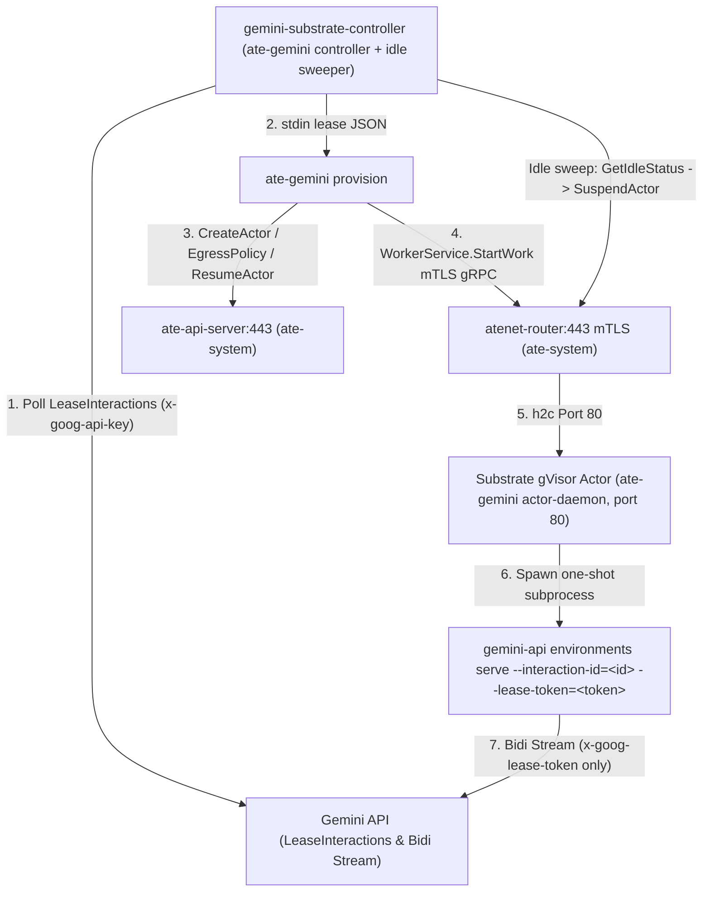

# Installing Gemini Self-Hosted Environments on Agent Substrate

This guide walks through installing Agent Substrate `v1` (`v1.0.0-rc.1`) on
Google Kubernetes Engine (GKE) and deploying `ate-gemini` with the Gemini API
CLI (`gemini-api`) to run Gemini API self-hosted workers in gVisor.

## Overview

A complete deployment runs two layers on a GKE 1.37+ cluster with Agent
Substrate `v1` installed:

1.  **Controller (`gemini-substrate-controller` `Deployment`)**: A single
    cluster-wide controller runs `ate-gemini controller`, which supervises
    `gemini-api environments poll` alongside a background
    `WorkerService.GetIdleStatus` idle-actor sweeper
    (`--worker-idle-timeout=1m0s`). It polls `LeaseInteractions` using
    `GEMINI_API_KEY` from the `gemini-credentials` Kubernetes `Secret` and
    invokes `ate-gemini provision`, dynamically routing each interaction to the
    `atespace` and `template` specified in `custom_config` (enforced against
    `--allowed-atespaces` and `--allowed-templates`) and suspending idle actors
    automatically between turns.
2.  **gVisor Actor Workers (`ActorTemplate` + `ate.dev/v1` `WorkerPool`, e.g.
    `gemini-env-actor` in `gemini-self-hosted`)**: Pre-warmed gVisor pods run
    `ate-gemini actor-daemon --port=80` as non-root user `1000:1000` with all
    Linux capabilities dropped (`capabilities.drop: ["ALL"]`). The
    `gemini-self-hosted` `Atespace` and `gemini-env-actor` `ActorTemplate`
    created below are **example** names—you can pre-create multiple `Atespace`s
    and `ActorTemplate`s on the cluster, list them in `--allowed-atespaces` /
    `--allowed-templates`, and pass the target `atespace`, `template`, initial
    `egress_policy`, and `env` inside `custom_config` on `CreateInteraction`
    (`POST /v1beta/interactions`) or `CreateEnvironment`
    (`POST /v1beta/environments`).



## Prerequisites

-   **GCP project**: Billing enabled, with GKE (`container.googleapis.com`) and
    Artifact Registry (`artifactregistry.googleapis.com`) APIs enabled.
-   **Gemini API key**: A project
    [Gemini API key](https://ai.google.dev/gemini-api/docs/api-key)
    (`GEMINI_API_KEY`) authorized for Gemini API `environments` and
    `interactions`.
-   **Workstation tools**: `gcloud`, `kubectl`, `gke-gcloud-auth-plugin`, `git`,
    `docker`, `jq`, Go 1.27+ (or Go 1.25+ with `GOTOOLCHAIN=auto`), and the
    [`gemini-api` CLI](https://github.com/google-gemini/gemini-api-cli):

    ```shell
    curl -fsSL https://raw.githubusercontent.com/google-gemini/gemini-api-cli/main/scripts/install.sh \
      | bash
    export PATH="$HOME/.local/bin:$PATH"
    ```
-   **`kubectl ate` CLI**: Built from the upstream
    [agent-substrate/substrate](https://github.com/agent-substrate/substrate)
    repository at `v1.0.0-rc.1`:

    ```shell
    git clone --branch v1.0.0-rc.1 https://github.com/agent-substrate/substrate.git
    GOTOOLCHAIN=auto go -C substrate install ./cmd/kubectl-ate
    export PATH="$(go env GOPATH)/bin:$PATH"
    ```

## Step 1: Provision GKE and Install Agent Substrate (`v1.0.0-rc.1`)

Agent Substrate `v1` requires GKE 1.37+ with `PodCertificate` APIs enabled and
an explicit SPIFFE allowlist for `atenet-router` mTLS ingress. Export
`ATE_INGRESS_ALLOWED_SPIFFE_IDS` for the controller's ServiceAccount
(`gemini-substrate-controller` in namespace `gemini-self-hosted`) before
launching the `substrate-gke` installer:

```shell
git clone https://github.com/ai-on-gke/substrate-gke.git
cd substrate-gke
gcloud auth application-default login

export ATE_INGRESS_ALLOWED_SPIFFE_IDS="spiffe://cluster.local/ns/gemini-self-hosted/sa/gemini-substrate-controller"
make run
```

When prompted by the wizard:

1.  **Images**: Choose **Pre-built images** with registry
    `ghcr.io/agent-substrate/substrate`, tag `v1.0.0-rc.1`, and commit
    `v1.0.0-rc.1` (or choose **Build from source** at `v1.0.0-rc.1`).
2.  **GCP Project & Cluster**: Select your GCP project and create a new GKE 1.37
    cluster (for example `ate-gemini-cluster` in `us-central1-a`). The installer
    provisions the cluster, a cluster-wide GCS snapshot bucket
    (`gs://<bucket-name>/`), and Workload Identity IAM bindings.
3.  **Allow ingress clients**: Confirm the prefilled SPIFFE ID
    `spiffe://cluster.local/ns/gemini-self-hosted/sa/gemini-substrate-controller`.
4.  **Sandbox runtime**: Select **gVisor** (the cluster-wide `gvisor-default`
    `SandboxConfig` is installed automatically).

Verify that the Substrate control plane pods are `Running`:

```shell
kubectl get pods --namespace=ate-system
```

## Step 2: Build the Local `ate-gemini` CLI Binary

Switch back to the `docs/self-hosted/agent-substrate/` directory of this
repository and build `ate-gemini` locally so you can generate the Substrate
`ActorTemplate` and Kubernetes manifests:

```shell
cd /path/to/gemini-api-cli/docs/self-hosted/agent-substrate
GOTOOLCHAIN=auto CGO_ENABLED=0 go build -o ate-gemini ./cmd/ate-gemini
```

## Step 3: Build and Push the Container Image

The included multi-stage [`Containerfile`](Containerfile) compiles both
`ate-gemini` and `gemini-api`
(`github.com/google-gemini/gemini-api-cli/cmd/gemini-api` via `go install`) and
packages them into a hardened Ubuntu 24.04 runtime image running as non-root
user `agent` (`1000:1000`, with zero file capabilities). Both the controller
`Deployment` and the gVisor `ActorTemplate` use this image (pinned by
`@sha256:...` digest).

```shell
export PROJECT_ID="YOUR_PROJECT_ID"
export REGION="us-central1"
export IMAGE_REPO="${REGION}-docker.pkg.dev/${PROJECT_ID}/ate-images/ate-gemini"

gcloud artifacts repositories create ate-images \
    --project="${PROJECT_ID}" \
    --repository-format=docker \
    --location="${REGION}" || true

gcloud auth configure-docker "${REGION}-docker.pkg.dev"
docker build \
    --file=Containerfile \
    --tag="${IMAGE_REPO}:latest" \
    .
docker push "${IMAGE_REPO}:latest"

export WORKER_IMAGE=$(gcloud artifacts docker images describe \
    "${IMAGE_REPO}:latest" \
    --format='value(image_summary.fully_qualified_digest)')
echo "Pinned WORKER_IMAGE=${WORKER_IMAGE}"
```

## Step 4: Create an Example `Atespace`, Grant `AccessPolicy`, and Apply the `ActorTemplate`

This guide uses `gemini-self-hosted` and `gemini-env-actor` as **example**
`Atespace` and `ActorTemplate` names (which also serve as fallback defaults when
a caller omits `atespace` or `template` from `custom_config`). Because
`ate-gemini provision` verifies that the requested `Atespace` already exists via
`ateapi.GetAtespace` and checks `--allowed-atespaces` / `--allowed-templates`
fail-closed, pre-create each `Atespace`, `AccessPolicy`, and `ActorTemplate` you
intend to use.

1.  Create the `gemini-self-hosted` `Atespace` and grant the controller
    ServiceAccount the `editor` role on `gemini-self-hosted` (`ate-api-server`
    enforces OpenFGA authorization on every RPC):

    ```shell
    kubectl ate create atespace gemini-self-hosted

    kubectl ate create access-policy -a gemini-self-hosted -f - <<'EOF'
    metadata:
      name: default
    bindings:
    - role: editor
      members:
      - user:system:serviceaccount:gemini-self-hosted:gemini-substrate-controller
    EOF
    ```

2.  Generate and apply the `ActorTemplate` (`SNAPSHOT_FIDELITY_MEMORY`, using
    the cluster-wide snapshot bucket configured by `substrate-gke` in Step 1):

    ```shell
    export CONTROL_PLANE_URL="https://generativelanguage.googleapis.com"

    ./ate-gemini manifest template \
        --namespace=gemini-self-hosted \
        --template=gemini-env-actor \
        --worker-image="${WORKER_IMAGE}" \
        --gemini-base-url="${CONTROL_PLANE_URL}" \
        | kubectl ate create actor-template -f -
    ```

> [!NOTE]
> The generated `ActorTemplate` never contains `GEMINI_API_KEY`. It runs
> `ate-gemini actor-daemon --port=80` as UID `1000` with
> `capabilities.drop: ["ALL"]` (Substrate's gVisor and micro-VM sandboxes allow
> unprivileged port `80` binds without `CAP_NET_BIND_SERVICE` or `setcap`).

## Step 5: Deploy the Controller and `ate.dev/v1` `WorkerPool`

Generate and apply the Kubernetes manifests using the upstream
`ateworker-gvisor` image
(`ghcr.io/agent-substrate/substrate/ateworker-gvisor:v1.0.0-rc.1`, or your
digest-pinned mirror in Artifact Registry). If you pre-created additional
`Atespace`s or `ActorTemplate`s in Step 4, pass them via `--allowed-atespaces`
and `--allowed-templates` (by default, the controller fails closed and permits
only `--namespace` and `--template`):

```shell
export GEMINI_API_KEY="your-gemini-api-key"
export WORKER_POOL_IMAGE="ghcr.io/agent-substrate/substrate/ateworker-gvisor:v1.0.0-rc.1"

./ate-gemini manifest \
    --namespace=gemini-self-hosted \
    --template=gemini-env-actor \
    --worker-image="${WORKER_IMAGE}" \
    --worker-pool-image="${WORKER_POOL_IMAGE}" \
    --gemini-base-url="${CONTROL_PLANE_URL}" \
    --replicas=3 \
    | kubectl apply --filename=-
```

This creates:

-   `Namespace` `gemini-self-hosted` labeled `ate.dev/api-access: "true"`
    (permitted by `ate-system` network policies to reach `ate-api-server:443`).
-   `ServiceAccount` `gemini-substrate-controller`.
-   `Secret` `gemini-credentials` holding **only** credentials
    (`GEMINI_API_KEY`, plus `GEMINI_ENVIRONMENT_KEY` if set) (mounted
    exclusively into `gemini-substrate-controller`, with no cross-namespace RBAC
    grants).
-   `ate.dev/v1` `WorkerPool` `worker-pool` with 3 pre-warmed gVisor pods
    (`sandboxClasses: [{name: gvisor}]`) for `workload: gemini-env-actor`.
-   Hardened `Deployment` `gemini-substrate-controller` mounting projected
    `ateapi-token`, `servicedns-ca`, and `podidentity` (`ECDSAP256` mTLS client
    bundle for `atenet-router:443`) volumes and passing
    `--worker-idle-timeout=1m0s` plus cluster settings as explicit CLI flags.

## Step 6: Verify the Deployment and Test End-to-End

### 1. Check Rollout and `WorkerPool` Status

```shell
kubectl rollout status deploy/gemini-substrate-controller \
    --namespace=gemini-self-hosted
kubectl get workerpool \
    --namespace=gemini-self-hosted
kubectl logs deploy/gemini-substrate-controller \
    --namespace=gemini-self-hosted \
    --tail=20
```

### 2. Inspect Substrate `ActorTemplate` and Actors

```shell
kubectl ate get actor-templates -a gemini-self-hosted
kubectl ate get actors -a gemini-self-hosted
```

### 3. Run an End-to-End Self-Hosted Interaction with `custom_config`

`ate-gemini` reads only `custom_config` (`atespace`, `template`,
`worker_url_template`, `env`, `egress_policy`). Pass it directly inside
`environment.custom_config` on `CreateInteraction`
(`POST /v1beta/interactions`):

```shell
curl --silent --fail \
    --request POST \
    --header "Content-Type: application/json" \
    --header "x-goog-api-key: ${GEMINI_API_KEY}" \
    --data '{
      "agent": "antigravity-preview-05-2026",
      "input": "Run uname -a and ls -la /workspace in bash.",
      "stream": false,
      "environment": {
        "type": "remote",
        "mode": "self_hosted",
        "custom_config": {
          "atespace": "gemini-self-hosted",
          "template": "gemini-env-actor",
          "egress_policy": {
            "rules": [
              {"tlsPassthrough": {"hostnames": ["pypi.org", "files.pythonhosted.org"], "ports": {"all": {}}}}
            ]
          },
          "env": {
            "APP_ENV": {"value": "staging"}
          }
        }
      }
    }' \
    "${CONTROL_PLANE_URL}/v1beta/interactions"
```

If you prefer to pre-create a reusable `self_hosted` environment and share its
`ENV_ID` across multiple turns, pass `custom_config` to
`POST /v1beta/environments` at creation time and reference `${ENV_ID}` in
subsequent interactions:

```shell
ENV_ID=$(curl --silent --fail \
    --request POST \
    --header "Content-Type: application/json" \
    --header "x-goog-api-key: ${GEMINI_API_KEY}" \
    --data '{"mode": "self_hosted", "custom_config": {"atespace": "gemini-self-hosted", "template": "gemini-env-actor"}}' \
    "${CONTROL_PLANE_URL}/v1beta/environments" \
    | jq --raw-output '.id')
echo "Created self_hosted environment: ${ENV_ID}"

gemini-api agent run \
    "Run uname -a and ls -la /workspace in bash." \
    --agent antigravity-preview-05-2026 \
    --body "{\"environment\": \"${ENV_ID}\"}"
```

Watch `kubectl ate get actors -a gemini-self-hosted` to observe the actor
transition to `RUNNING` during the turn and automatically checkpoint to
`SUSPENDED` once idle for `--worker-idle-timeout` (`1m0s` by default).

## Operational Notes and Troubleshooting

### Outbound Network Egress and Egress Immutability

In Agent Substrate `v1`, outbound traffic from an actor is **denied by
default**. `ate-gemini provision` creates the actor's `default` `EgressPolicy`
from `custom_config.egress_policy`, a Substrate
[`EgressPolicy`](https://github.com/agent-substrate/substrate/blob/v1.0.0-rc.1/api/ateapi/v1/ateapi.proto)
in protobuf JSON (only `rules`; `metadata` is set by `ate-gemini`):

-   **Passed through unchanged**: `http`, `https` (intercepted), and
    `tlsPassthrough` rules, including their `ports`, work as in Substrate, and
    `ate-api-server` validates them. See upstream
    [egress traffic](https://github.com/agent-substrate/substrate/blob/v1.0.0-rc.1/docs/guides/egress-traffic.md)
    for what the gateway can and cannot allow (for example, raw TCP and non-DNS
    UDP are always blocked).
-   **No rule effects**: `ate-gemini` rejects rules with `effects` (credential
    header injection and actor JWTs). Any caller who can create interactions
    controls `custom_config`, so effects would let them send your credentials or
    actor identity tokens to a host they choose.
-   **Gemini API access is always added**: `ate-gemini` appends a
    `tlsPassthrough` rule on every port for `generativelanguage.googleapis.com`
    (plus any custom `server_url` hostname) so the worker can open its Gemini
    API stream, unless your rules already name that host on every port.
-   **Default without `egress_policy`**: Only the Gemini API host is reachable.
-   **Initial egress configuration is immutable**: The policy is applied once
    when the actor is first created and preserved across all subsequent turns
    and resumes. To change egress rules, create a new environment.

For example, to allow any TLS destination plus plain HTTP on ports `80` and
`8080`:

```json
{
  "egress_policy": {
    "rules": [
      {"http": {"hostnames": ["*"], "ports": {"numbers": [80, 8080]}}},
      {"tlsPassthrough": {"hostnames": ["*"], "ports": {"all": {}}}}
    ]
  }
}
```

### Multi-Tenant Allowlists (`--allowed-atespaces` and `--allowed-templates`)

By default, `ate-gemini` fails closed and only allows `custom_config.atespace`
and `custom_config.template` values matching `--atespace`
(`gemini-self-hosted`) and `--template` (`gemini-env-actor`). To serve multiple
pre-created `Atespace`s or `ActorTemplate`s from a single controller:

1.  Create each `Atespace` and bind `role: editor` for
    `user:system:serviceaccount:gemini-self-hosted:gemini-substrate-controller`
    via `kubectl ate create access-policy -a <atespace> -f -` (if using wildcard
    `--allowed-atespaces=*`, also grant `role: viewer` on `--global` so the idle
    sweeper can list actors across all `Atespace`s).
2.  Pass `--allowed-atespaces=gemini-self-hosted,team-a` and
    `--allowed-templates=gemini-env-actor,gpu-actor` to `ate-gemini manifest` /
    `ate-gemini controller`.

> [!WARNING]
> These allowlists only bound which `Atespace`s and `ActorTemplate`s the
> controller may use. They are not per-user access control: `ate-gemini` does
> not authenticate the callers behind an interaction, so any interaction leased
> to the project can select any allowlisted `atespace` and `template`. Enforce
> authentication and ACL checks in the service that wraps this system (see
> [README.md](README.md)).

## Cleanup

Stop the controller first so it cannot lease new interactions or recreate actors
during cleanup. Then delete any actors in the `Atespace`, the `ActorTemplate`,
the `Atespace`, and the Kubernetes `Namespace`:

```shell
kubectl delete deployment gemini-substrate-controller --namespace=gemini-self-hosted

kubectl ate get actors -a gemini-self-hosted
# For each actor returned above:
# kubectl ate delete actor <actor-name> -a gemini-self-hosted

kubectl ate delete actor-template gemini-env-actor -a gemini-self-hosted
kubectl ate delete atespace gemini-self-hosted
kubectl delete namespace gemini-self-hosted --ignore-not-found
```
