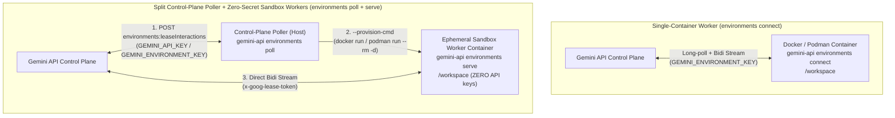

# Running Gemini API Self-Hosted Environments in Containers

This directory provides hardened multi-stage container build definitions and
direct CLI recipes for running **Gemini API Self-Hosted Environments** in
**Docker** and **rootless Podman**.

## Execution Models: Single Container vs. Split Poller + Sandbox Workers

The `gemini-api` CLI (`github.com/google-gemini/gemini-api-cli`) supports two
container execution models:

<!-- mdformat off(GFM single-line table for GitHub compatibility) -->
Dimension                          | Single Container (`environments connect`)                                          | Split Poller + Sandbox Workers (`environments poll` + `environments serve`)
:--------------------------------- | :--------------------------------------------------------------------------------- | :--------------------------------------------------------------------------
**CLI Command**                    | `gemini-api environments connect`                                                  | Poller: `gemini-api environments poll` Worker: `gemini-api environments serve`
**Credential Boundary**            | Container holds `GEMINI_ENVIRONMENT_KEY`.                                          | **Zero API keys and zero environment keys inside the worker container.** Only the host poller holds long-lived keys; the worker container receives only a short-lived, interaction-scoped `--lease-token`.
**Multi-Environment Multiplexing** | 1 container = 1 pre-registered `environment_id`.                                   | 1 poller can lease work across **all** self-hosted environments in a project and spawn isolated `--rm` containers on demand.
**Multi-Turn State Persistence**   | `/workspace` persists in the long-running container or mounted volume.             | Mounting a per-environment named volume (`gemini-self-hosted-<hash>`) at `/workspace` preserves `/workspace` across turns while `--rm` scales idle containers to zero between turns.
**Best For**                       | Quick single-environment deployments, dedicated developer workspaces, CI sidecars. | Multi-tenant fleet hosting, strict secret isolation against untrusted code execution, scale-to-zero container pools.
<!-- mdformat on -->

## Choosing a Container Runtime: Docker vs. Rootless Podman

<!-- mdformat off(GFM single-line table for GitHub compatibility) -->
Feature                       | [Docker (`docker/`)](docker/README.md)                       | [Rootless Podman (`podman/`)](podman/README.md)
:---------------------------- | :----------------------------------------------------------- | :----------------------------------------------
**Daemon Model**              | Root-privileged daemon (`dockerd`) or Docker Rootless mode.  | Daemonless, fork/exec model running entirely as an unprivileged host user.
**User Namespace Isolation**  | Optional (`--userns=host` by default unless configured).     | Built-in rootless user namespaces (`--userns=keep-id:uid=1000,gid=1000`).
**Network Isolation**         | Custom bridge networks or `--network=none` / firewall rules. | Userspace networking via `pasta` (`--network=pasta`) with no root privileges required.
<!-- mdformat on -->

## Container Security Hardening Checklist

Because an AI agent executes model-generated shell commands (`execute_bash`) and
modifies files (`write_file`, `edit_file`) inside the container, always apply
defense-in-depth hardening flags on worker containers:

1.  **Zero Long-Lived Credentials in Worker Containers (`poll` + `serve`)**:
    -   Run `gemini-api environments poll` outside the untrusted container
        boundary and pass only `--interaction-id` and `--lease-token` into
        `gemini-api environments serve`.
    -   Even if model-generated code inspects `/proc/self/environ` or container
        memory, no `GEMINI_API_KEY` or `GEMINI_ENVIRONMENT_KEY` is present in
        the worker container.
2.  **Drop All Linux Capabilities**:
    -   Always pass `--cap-drop=ALL` so processes inside the container cannot
        manipulate kernel network stacks, mount filesystems, or trace host
        processes.
3.  **Block Privilege Escalation**:
    -   Pass `--security-opt=no-new-privileges` to prevent `setuid`/`setgid`
        binaries from escalating privileges.
4.  **Run as an Unprivileged UID/GID**:
    -   Both [`Dockerfile`](Dockerfile) and [`Containerfile`](Containerfile)
        create an unprivileged `agent` user (`1000:1000`) and run with
        `USER 1000:1000`.
5.  **Enforce Resource Quotas (Fork-Bomb & OOM Protection)**:
    -   Set `--pids-limit=256` (or lower) to stop fork bombs.
    -   Set `--memory=2g` and `--cpus=2` to bound CPU and memory consumption.
6.  **Filesystem Boundary & Read-Only Root**:
    -   Constrain the runtime file tools via
        `--root-dir=/workspace --workdir=/workspace`.
    -   Mount the root filesystem read-only (`--read-only`) with writable mounts
        only at `/workspace` and `--tmpfs /tmp:rw,noexec,nosuid,size=512m`.
7.  **Network Egress Control**:
    -   The worker container only needs outbound HTTPS (`TCP 443`) to
        `generativelanguage.googleapis.com` (plus any domains your workload
        requires). Block RFC1918 private LAN and cloud metadata
        (`169.254.169.254`) ranges via container firewall rules or network
        policies.

## Directory Contents

-   [`Dockerfile`](Dockerfile) — Multi-stage build compiling `gemini-api`
    (`golang:1.26-bookworm`) into a clean `python:3.12-slim-bookworm` runtime
    image with `bash`, `git`, `curl`, `jq`, `ripgrep`, and non-root user `agent`
    (`1000:1000`).
-   [`Containerfile`](Containerfile) — OCI/Podman-compatible multi-stage build
    definition identical in layout to `Dockerfile`.
-   [`docker/`](docker/README.md) — Direct `docker` + `gemini-api` CLI recipes
    for single-container (`environments connect`) and split poller + ephemeral
    worker (`environments poll` + `environments serve`) execution.
-   [`podman/`](podman/README.md) — Direct rootless `podman` + `gemini-api` CLI
    recipes with `--userns=keep-id` and `--network=pasta`.
